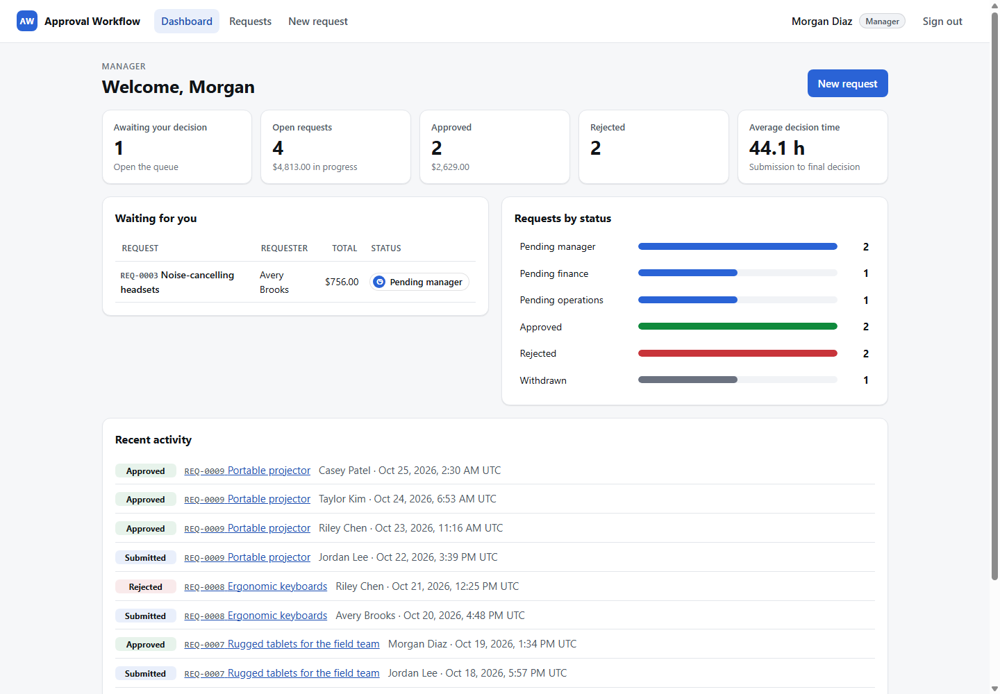
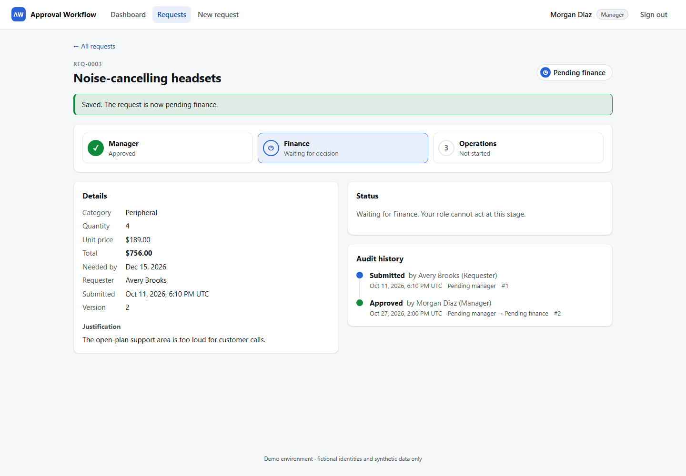
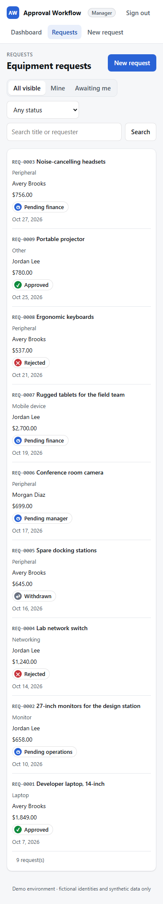
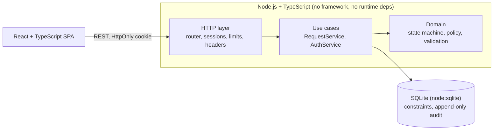
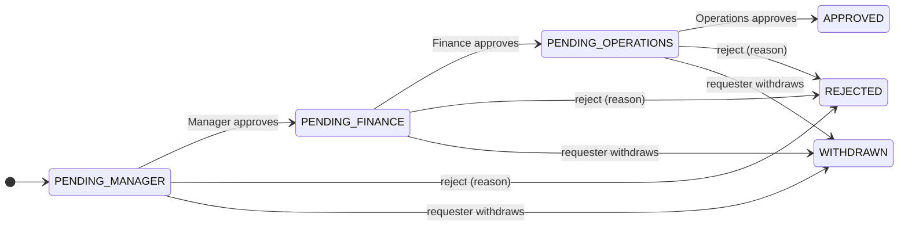

# Approval Workflow Platform

**A full-stack approval workflow with server-side authorization, an auditable state machine and real
concurrency control.** Employees request equipment; Manager, Finance and Operations approve in sequence; every
decision is recorded in an append-only history.

React + TypeScript on the front, Node.js + TypeScript and SQLite on the back. The server has zero runtime
dependencies and the whole demo runs locally with synthetic data.



> **Independent demonstration.** Original code built from general software patterns. All people, requests and
> amounts are fictional. It has not been deployed and makes no production claims.

## The problem

Approval flows look simple and fail in subtle ways:

- **Authorization hides in the UI.** A hidden button is not a permission check; the API must enforce who can act.
- **Concurrent decisions overwrite each other.** Two approvers acting on the same request at once must not both win.
- **History gets lost or edited.** Auditors need to know who decided what, when and why, and trust that it was not changed.
- **Invalid states slip in.** A request must never skip a stage, be approved twice, or be decided by its own requester.

## Features

- **Three-stage sequential approval** (Manager → Finance → Operations), rejection with a mandatory reason, and
  withdrawal by the requester, defined as a transition table.
- **Server-side authorization** for every read and write: stage roles, separation of duties, owner-only withdrawal,
  a read-only auditor, and `404` for requests a requester may not see.
- **Optimistic concurrency**: each action carries the version the user saw; stale actions get `409 CONFLICT`.
- **Append-only audit trail** written in the same transaction as each change and protected by database triggers.
- **Data integrity in the database**: `STRICT` tables, `CHECK` constraints, foreign keys, integer-cent money.
- **Local demo authentication**: seven fictional identities, scrypt-hashed passwords, `HttpOnly` +
  `SameSite=Strict` session cookies, hashed session tokens.
- **Interactive dashboard**: personal queue, status overview with drill-down, totals, average decision time and
  recent activity.
- **Responsive, accessible UI** in light and dark mode: status color always paired with icon and label, tables that
  become cards on phones.
- **81 automated tests** plus an optional browser smoke test.

| Request detail with stage tracker and audit history | Phone layout |
|---|---|
|  |  |

## Architecture





Details: [architecture](docs/architecture.md) · [workflow, authorization and concurrency](docs/workflow.md) ·
[REST API](docs/api.md) · [security model](docs/security.md) · [design decisions](docs/design-decisions.md).

## Tech stack

| Layer | Choice |
|---|---|
| Frontend | React 19, TypeScript, Vite; hash routing and state with plain React hooks |
| Backend | Node.js 24+ with native TypeScript execution, `node:http`, `node:crypto` |
| Database | SQLite through the built-in `node:sqlite` module, ordered migrations, WAL mode |
| Testing | `node --test` for the server; Vitest, Testing Library and jsdom for the client |
| Tooling | npm workspaces, strict TypeScript, GitHub Actions on Ubuntu and Windows with Node.js 24 and 26 |

## Quick start

Requirements: Node.js 24 or newer (developed on 26.12.1). No database server, no accounts, no network services.

```bash
git clone <repository-url>
cd approval-workflow-platform
npm ci              # install from the lockfile
npm run build       # build the web client
npm start           # API + client on http://127.0.0.1:3000
```

On first start the server creates `data/app.db` and seeds nine synthetic requests covering every status.
`npm run seed` resets it. For development with hot reload, run `npm run dev:server` and `npm run dev:web`
(Vite on http://127.0.0.1:5173, proxying `/api`).

| Variable | Default | Purpose |
|---|---|---|
| `PORT` / `HOST` | `3000` / `127.0.0.1` | Listen address (loopback only by default) |
| `DATABASE_PATH` | `data/app.db` | SQLite file |
| `DEMO_MODE` | `true` | Show demo identities on the login screen |
| `COOKIE_SECURE` | `false` | Add `Secure` to the session cookie behind HTTPS |

## Demo walkthrough

Sign in with any identity on the login screen (they all use the demo password `demo-pass`):

| Identity | Role | Try this |
|---|---|---|
| Avery Brooks, Jordan Lee | Requester | Create a request, follow it through the stages, withdraw a pending one |
| Morgan Diaz, Riley Chen | Manager | Approve or reject in the queue; open REQ-0006, Morgan's own request, to see separation of duties |
| Taylor Kim | Finance | Decide on REQ-0007, waiting at the finance stage |
| Casey Patel | Operations | Give final approval to REQ-0002 |
| Quinn Foster | Auditor | Browse everything; no write actions are offered or allowed |

Open the same request as two managers in two browsers and approve in both: the second gets a conflict message
with a reload button instead of overwriting the first decision.

### Example: approving over the API

```http
POST /api/requests/3/approve
Content-Type: application/json
Cookie: awp_session=…

{ "version": 1, "comment": "Within the team budget." }
```

`200` returns the updated request, its audit events and the caller's `allowedActions`. Sending `version: 1` again
returns `409 CONFLICT`; a finance user trying the same call at the manager stage gets `403 FORBIDDEN`.

## Testing

```bash
npm test            # 58 server tests (node --test) + 23 web tests (Vitest)
npm run verify      # typecheck + tests + production build
```

Highlights: the full role × status × action authorization matrix; five simultaneous HTTP approvals with exactly
one winner; lost-update prevention across two database connections; `503` under a held write lock; a 400-step
randomized invariant walk; append-only audit triggers; rollback when the audit insert fails; persistence across
restarts; and negative tests for login, sessions, forged cookies, roles, content types and payload size. The
GitHub Actions workflow runs the typecheck, both test suites and the production build on Ubuntu and Windows with
Node.js 24 and 26. See [testing](docs/testing.md).

## Project status

| | Scope |
|---|---|
| **Implemented** | Three-stage workflow, rejection and withdrawal, server-side authorization, optimistic concurrency, append-only audit trail, SQLite persistence and migrations, demo authentication with sessions, dashboard, request list with filters and search, request creation with validation, responsive light and dark UI, synthetic seed data, 81 automated tests, optional browser smoke test |
| **Simulated** | Corporate identity: seeded fictional users with a shared demo password instead of an identity provider. The organization and its approval chain are fixed fixtures |
| **Planned** | OIDC sign-in, configurable approval routes, notifications through an outbox, attachments, login rate limiting, structured logging, end-to-end tests in CI |
| **Not tested** | macOS, browsers other than Chrome, screen readers, load and performance. Node.js 24 and Linux are covered by the CI workflow only, not by local runs |

## Limitations and roadmap

- Demo authentication only; no MFA, rate limiting or TLS (expected from a reverse proxy).
- Fixed three-stage chain; no notifications or attachments.
- Single process and SQLite file: right for a demo or a small team, not for horizontal scaling.

The roadmap and the full list are in [limitations and roadmap](docs/roadmap.md).

## AI-assisted development

Built with AI assistance: the code, tests and documentation were drafted with Claude Code (Anthropic) under the
author's direction. The author defined the scope, constraints and acceptance criteria and is responsible for
reviewing and approving every change before publication. Test results and screenshots come from actual local runs.

---

**License:** not yet selected.
