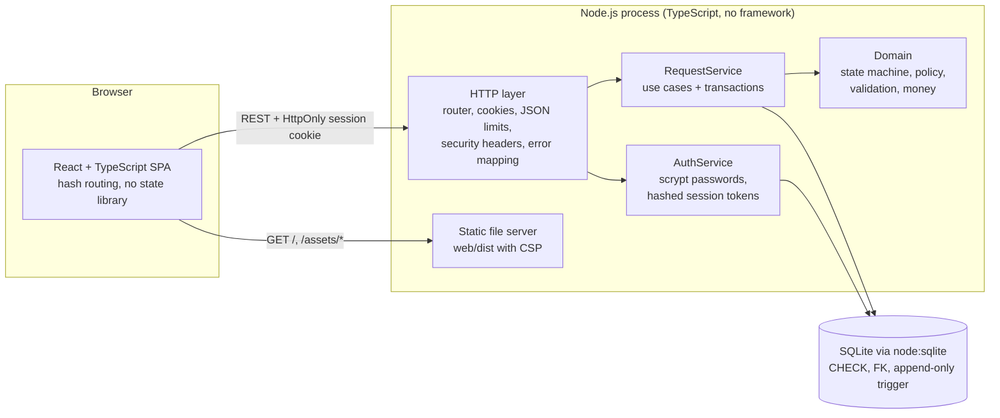
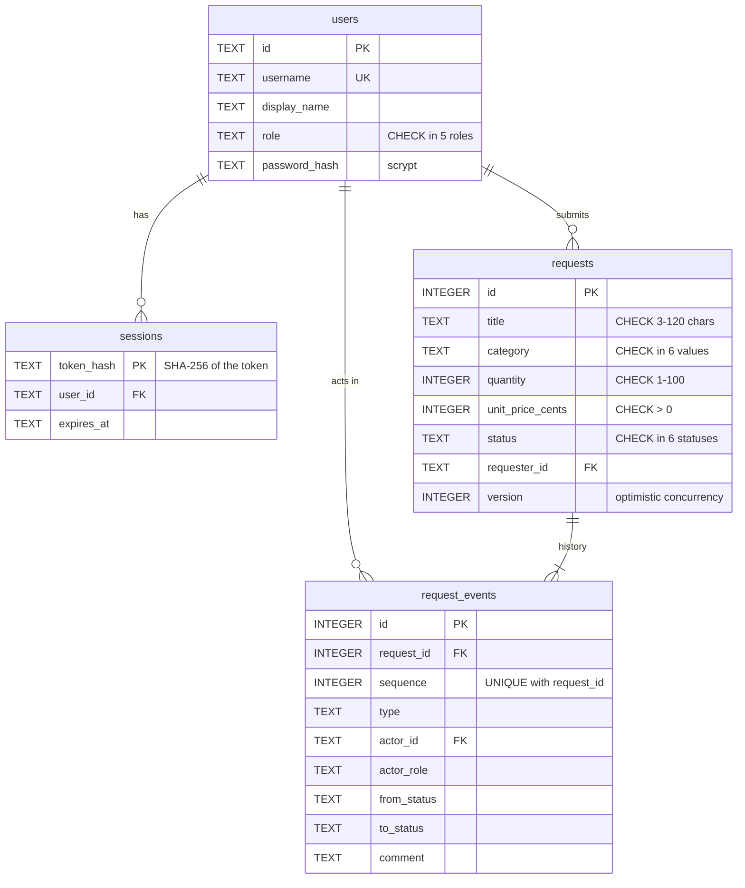
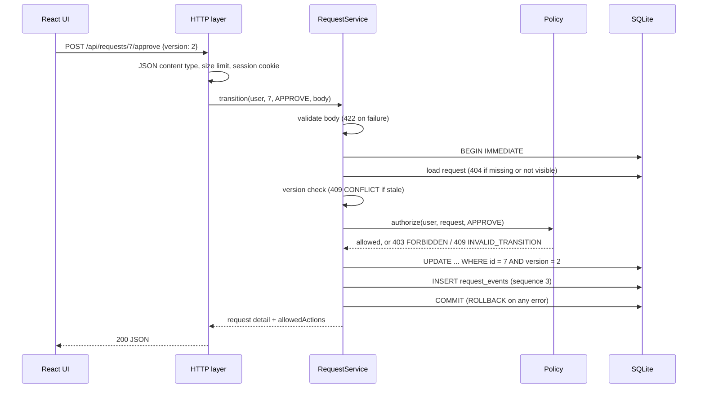

# Architecture

Everything described here exists in the current release. Planned work is listed only in [roadmap.md](roadmap.md).

## System overview



One process serves both the API (`/api/*`) and the built client, so the browser talks to a single origin and the
session cookie can be `SameSite=Strict`. During development Vite serves the client and proxies `/api` to the API.

## Server layers

| Layer | Path | Responsibility |
|---|---|---|
| Contract | `shared/contracts.ts` | Roles, statuses, actions, DTOs and error codes shared with the client |
| Domain | `server/src/domain` | `stateMachine.ts` (transition table), `policy.ts` (authorization), `validation.ts`, `money.ts`. Pure functions, no I/O |
| Application | `server/src/application` | `RequestService` and `AuthService` use cases, typed `AppError`s, injectable `Clock` |
| Infrastructure | `server/src/infrastructure` | SQLite connection and migrations, scrypt hashing, synthetic seed data |
| HTTP | `server/src/http` | Router, request handling, static files |
| Composition | `server/src/composition.ts`, `main.ts` | Wiring from configuration and environment variables |

The server has **no runtime dependencies**: HTTP, SQLite (`node:sqlite`), hashing (`node:crypto`) and TypeScript
execution (type stripping) all come from Node.js itself.

## Data model



- Tables are `STRICT`; foreign keys are enforced (`PRAGMA foreign_keys = ON`).
- `request_events` is append-only: `BEFORE UPDATE` and `BEFORE DELETE` triggers abort any change.
- A request's `version` equals its number of events; the event `sequence` is the version it produced.
- Money is stored as integer cents; totals are computed, never stored.
- Schema changes are ordered migrations tracked in `PRAGMA user_version`.
- File databases use WAL mode and a 5-second busy timeout.

## Request lifecycle of a write



## Web client

| Path | Responsibility |
|---|---|
| `web/src/api.ts` | Typed fetch client; turns error bodies into `ApiError` with field details |
| `web/src/auth.tsx` | Session context; probes `/api/auth/session` at startup |
| `web/src/router.ts` | Hash routing with `useSyncExternalStore` |
| `web/src/pages/*` | Login, dashboard, request list, request detail, new request |
| `web/src/components/*` | Status badge, stage tracker, action panel, timeline, feedback |

The client never decides what a user may do: the server returns `allowedActions` for each request, computed by the
same policy that guards the write endpoints.

## Repository layout

```
shared/        API contract and demo constants used by both sides
server/
  src/         domain, application, infrastructure, http, composition, main
  test/        node:test suites (unit, integration, integrity, concurrency, persistence)
web/
  src/         React application
  test/        Vitest + Testing Library suites
scripts/       browser-smoke.mjs (optional Chrome DevTools Protocol smoke test)
docs/          this documentation and screenshots
```
