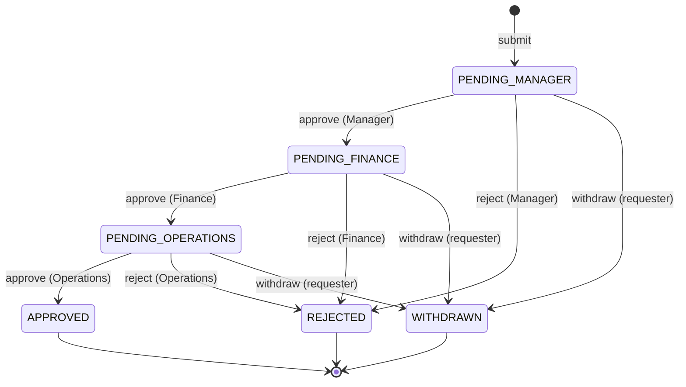

# Workflow, authorization and concurrency

## State machine

The transitions are a data table (`server/src/domain/stateMachine.ts`). Terminal states have no outgoing
transitions, so any action on them fails with `409 INVALID_TRANSITION`.

## Roles

| Role | Can submit | Sees | Acts |
|---|---|---|---|
| Requester | yes | own requests only | withdraw own pending requests |
| Manager | yes | all requests | approve or reject at `PENDING_MANAGER` |
| Finance | yes | all requests | approve or reject at `PENDING_FINANCE` |
| Operations | yes | all requests | approve or reject at `PENDING_OPERATIONS` |
| Auditor | no | all requests | nothing (read-only) |

## Authorization rules

All decisions come from `authorize(actor, request, action)` in `server/src/domain/policy.ts`, in this order:

1. **Transition exists**: otherwise `409 INVALID_TRANSITION` (for example, approving an approved request).
2. **Withdraw**: only the requester (`403 FORBIDDEN` for anyone else).
3. **Approve or reject**: the actor's role must match the current stage (`403 FORBIDDEN`).
4. **Separation of duties**: nobody approves or rejects their own request, even with the right role (`403`).

Visibility is checked before all of that: a requester asking for someone else's request gets `404 NOT_FOUND`,
the same answer as for a missing request, so the API does not reveal which requests exist.

The UI shows only the actions in `allowedActions`, which the server computes with the same `authorize` function.
Hiding a button is a convenience; the write endpoint re-checks everything.

A rejection requires a reason of at least 10 characters (`422 VALIDATION_FAILED` otherwise).

## Audit trail

Every successful write appends one `request_events` row in the same transaction as the status change:
who acted, in which role, from which status to which, with the comment and a timestamp. The database refuses
updates and deletions of this table, and a failed audit insert rolls back the status change with it.

## Concurrency

The server uses optimistic concurrency with a per-request `version`:

1. The client sends the `version` it last saw with every action.
2. Inside `BEGIN IMMEDIATE`, the service compares it with the stored version: a mismatch returns
   `409 CONFLICT` and nothing changes.
3. The `UPDATE` is also guarded by `WHERE version = ?`, so a writer on another connection cannot cause a lost
   update even between the read and the write.
4. `BEGIN IMMEDIATE` takes SQLite's write lock up front. If another connection holds it beyond the busy timeout,
   the API answers `503 SERVICE_BUSY` instead of failing halfway through.

In the UI, a `409` shows the server's message with a **Reload request** button.

What the tests prove (see [testing.md](testing.md)):

- five simultaneous approvals over HTTP with the same version produce exactly one `200` and four `409`s;
- two connections to the same database file cannot overwrite each other's decision;
- a held write lock yields `503 SERVICE_BUSY`, and the same call succeeds once the lock is released;
- a 400-step randomized walk keeps every invariant: one event per version, sequential stages, status equal to
  the last event, no self-decisions, failed actions change nothing.
